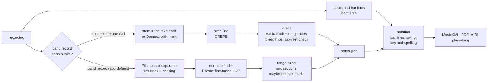

# Saxscribe: Project Handbook

Where things stand, what happens next, and how to run the tool, all in one place.
Read sections 1 and 2 to catch up. Sections 3 to 9 are reference.

Web page version (bookmark this, works on the iPad): <https://claude.ai/artifact/LHvpK1sBSP8ADqziMc2c8X>.
Model dashboard (scores and charts, no app needed): <https://claude.ai/artifact/TRLsrbmKzM2UVwaaW8atZr>.
After any change, run `python3 scripts/handbook.py` then `python3 scripts/handbook_page/build.py`, and republish the page.
After new results, also run `python3 scripts/dashboard_page/build.py` and republish the dashboard.

Sections 1, 2 and 5 are rebuilt from the repo's own records by
`python3 scripts/handbook.py`: the benchmark rows in
`docs/evaluation/experiments.jsonl`, the evaluation log, and the plan in
`docs/product/next.json`. Don't edit them here; change the source and rerun
the script. CI fails if they are out of date.

Last updated: 2026-11-13

---

## 1. Status

<!-- auto:status -->
| | |
| --- | --- |
| Default on band records (app) | **Our sax model**: the Filosax sax separator plus our fine-tuned note finder (E77), "D" in the scorecards ([ADR-0041](docs/decisions/0041-band-records-default-to-our-sax-model.md)) |
| Default on solo takes and the CLI | **Standard path**: Basic Pitch notes, CREPE pitch line; Demucs first when `--mix` |
| Benchmark score (E81, 33 trusted songs) | Note F1 **50.9** with our sax model, against 39.7 for the standard path. Onset F1 74.4 against 63.7. Note F1 without note ends: 66.9 |
| How the 33 songs break down | 12 of 33 at note F1 60 or above. Our sax model beats the standard path on 31 of 33 |
| Weakest songs (our sax model) | Castle Rock 22.6, Bloody Well Right 22.7, St. Louis Blues 28.0, True 28.2, Just for the Love 29.8, Walker's Theme 31.2 |
| Where the notes go wrong (key notes, E81) | 66% right, 13% missed, 8% start off, 8% wrong pitch, 5% merged. Note ends cost about 16 points of note F1 on average |
<!-- /auto:status -->

**Biggest open weaknesses:** quiet low sax, other instruments (vocals
especially) leaking into the sax track, and where notes end.

---

## 2. What's next

<!-- auto:next -->
The plan Austin approved on 2026-11-13 (one step at a time; each needs his go in the build thread):

| Step | What | Status |
| --- | --- | --- |
| 1 | **Diagnose**: per-song loss breakdown, a stem check on the missed notes of the 6 weakest songs, and the flagged takes (Najee, Burning Daylight, Just the Two of Us) | Done 2026-11-13: 87% of missed or wrong-pitch notes are still in the stem, so the note finder is the bottleneck; about half our notes in the flagged pop bars overlap vocals (log, 2026-11-13 diagnosis) |
| 2 | **Note-end ear check**: Austin listens to about 100 note ends on 3 songs, to decide whether the 60 target counts note ends | Not started |
| 3 | **New test set**: bars from Austin's flags, 3–5 pop songs with vocals, 3 soprano songs | Not started |
| 4 | **E82, vocals**: check the Demucs vocal stem, MVSep Mega and the MERT judge against vocals leaking in. Mark, never hide | E82 done 2026-11-13, not adopted: Demucs's vocal stem carries the sax on instrumentals. Next: round 3 with Mega vocals, or a vocal tuning set first (Austin's choice) |
| 5 | **E83**: whatever steps 1–2 point to (a note-end fix, or a second fine-tune that adds R&B, pop and soprano) | Not started |
| 6 | **Rhythm**: a simpler-grid rule | Not started |
| 7 | **Docs, dashboard, not-sax instrument choices**: the handbook, a static dashboard page, and which other instruments the not-sax check names | In progress: handbook, its update script and the static dashboard done; not-sax instrument choices next |

**Running on the Mac now:** the overnight search for better recordings of the charts that failed the match check (`find_better_recording.py`). A thread files the winners in the morning; nothing gets filed without a passing line-up.

**Waiting on Austin:**
- Choose the E82 follow-up: round 3 with Mega vocals, or a vocal tuning set first.
- Step 2 ear check when it's ready.
- Which note F1 the 60 target means: with note ends or without.
- Filosax dataset access: if Zenodo hasn't answered by about 11-14, send the drafted email.

_Plan last changed 2026-11-13._
<!-- /auto:next -->

Ideas for later live in the "Later" section of the
[roadmap](docs/product/roadmap.md#later).

---

## 3. How the tool works

Four layers, each saved to its own files, so a fix to one never throws away
the ones below it ([ADR-0002](docs/decisions/0002-four-layers-on-disk.md)).
Pitch is stored at concert pitch.



| Layer | File | Band record (app default) | Solo take / CLI default |
| --- | --- | --- | --- |
| 1. Isolate | `stem.wav` | Filosax separator (Riley & Dixon) | The take itself, or Demucs `htdemucs_6s` with `--mix` (stem picked automatically) |
| 2. Pitch line | `contour.csv` | CREPE, every 10 ms | CREPE, every 10 ms |
| 3. Notes | `notes.json` | Our fine-tuned Filosax note finder. The sax-rest cut and bleed hide are skipped, so sax sections and maybe-not-sax marks are the guards | Basic Pitch, then range rules, bleed hide, held notes following the pitch line, sax-playing check |
| 4. Notation | `score*.musicxml`, PDF, MIDI | Beat This! beats, bar lines, swing, key | Same |

Rules that never change: real notes are never deleted, only tagged
(`not_sax`, `maybe_not_sax`); nothing below the horn's low B-flat goes on the
sheet ([ADR-0033](docs/decisions/0033-nothing-below-the-low-note.md)).

More detail: [architecture](docs/architecture/system.md), the
[pipeline map](https://claude.ai/artifact/9GA8JiUGaqBoNsiM1Swbe6) (drawn before
D became the default), and the [model cards](docs/models/README.md).

---

## 4. Quick run

**After merging PRs: update and start the app.** In the Terminal window where
the app is running, press Ctrl-C, then:

```bash
cd ~/Desktop/saxscribe && git checkout main && git pull && source .venv/bin/activate && pip install -r requirements.lock && python -m saxscribe app
```

**Start the app without updating:**

```bash
cd ~/Desktop/saxscribe && source .venv/bin/activate && python -m saxscribe app
```

The app is at http://localhost:8765 (key review: `/results`, Needs review; scores and charts are on the model dashboard linked at the top). On the iPad on the
same Wi-Fi, open the address it prints. Sheet music is also copied to
`~/Desktop/Saxscribe`.

**Transcribe from the Terminal** (after `source .venv/bin/activate`):

```bash
python -m saxscribe transcribe ~/Music/take.wav --horn alto
python -m saxscribe transcribe ~/Music/record.mp3 --mix --horn tenor
python -m saxscribe transcribe ~/Music/record.mp3 --mix --separator filosax --notes-tool filosax --horn tenor
```

The third line is the app's band-record default (our sax model) on the CLI.

**Dashboard with the very latest runs** (including runs not logged in the repo
yet). It opens in your browser and stays on the Mac:

```bash
cd ~/Desktop/saxscribe && source .venv/bin/activate && python3 scripts/dashboard_page/build.py --runs ~/saxscribe-runs --open
```

The online dashboard linked at the top is rebuilt from the repo each time a
result is logged. Its top line says which experiment its data runs to.

**Check the tools are installed:** `python -m saxscribe check`

**Long jobs on the Mac:** the Mac sleeps after a minute idle. Wrap the
*whole* job in one `caffeinate`, and keep it plugged in:

```bash
caffeinate -dims bash -c 'first command && second command'
```

**What's running on the Mac right now:**

```bash
ps -eo pid,lstart,command | grep -E "python|caffeinate" | grep -v grep
```

---

## 5. Results at a glance

<!-- auto:results -->
**How we got here** (E81, mean on the 33-song benchmark):

| Version | Note F1 | Onset F1 |
| --- | --- | --- |
| #9 (2026-11-02) | 32.1 | 57.6 |
| #35 write only where the sax plays | 35.9 | 59.4 |
| #57 restore re-tongued repeats | 37.5 | 61.5 |
| #81 nothing below the low note | 38.8 | 62.3 |
| Standard path (8835ad0) | 39.7 | 63.7 |
| **Our sax model (8835ad0, default on band records)** | 50.9 | 74.4 |

Note F1 by group:

| Group | Standard path | Our sax model |
| --- | --- | --- |
| Austin's 6 tunes (6) | 34.2 | 43.4 |
| Transcribed songs (24) | 38.8 | 50.4 |
| Parker test (3) | 57.3 | 69.6 |

**Latest experiments:**

| E | Date | What | Outcome |
| --- | --- | --- | --- |
| E82 | 2026-11-13 | Vocal review mark on setup D, rule V | Not adopted: Demucs's vocal stem carries the sax on instrumentals, so a vocal mark also hits real sax. |
| E81 | 2026-11-12 | Benchmark re-score: six versions of the tool on 33 trusted songs | Our sax model ahead on 31 of 33 songs (note F1 50.9 vs 39.7). |
| E80 | 2026-11-10 | Our fine-tuned note finder in the app path: four setups compared | Filosax separator + our finder won all 9 songs; now the band-record default (ADR-0041). |
| E79 | 2026-11-09 | Sax judge: is a sax playing, and which one? | MERT judges sax best (AUC 0.93); not wired in yet. |
| E78 | 2026-11-09 | Answer keys from Austin's 8 transcription PDFs | Baseline on Austin's printed transcriptions: mean note F1 21.5. |
| E77 | 2026-11-09 | Fine-tuning the Filosax note finder on Mega sax stems | Gained on every test set; became the default's note finder after E80. |
| E76 | 2026-11-09 | Training set for the note finder: Mega-separated Weimar and Parker solos | 134 solo spans ready for fine-tuning. |
| E75 | 2026-11-08 | New alto etude answer keys: Ferling Op. 31 and Luft Op. 1 No. 2 | Baseline 57.5; slow studies lose on held notes split by vibrato. |
| E74 | 2026-11-08 | Note-finder settings on Mega sax stems | No gain from note-finder settings. |
| E73 | 2026-11-08 | How many key notes each separator's stem still holds | Mega's stem keeps the most key notes (57 of 59); the note finder is the gap. |

Full record: [evaluation log](docs/evaluation/log.md). Charts: the [model dashboard](https://claude.ai/artifact/TRLsrbmKzM2UVwaaW8atZr) (Progress, Songs, Lab, Log; rebuilt with `python3 scripts/dashboard_page/build.py`). Reviewing keys and flags stays in the app (`/results`, Needs review).
<!-- /auto:results -->

---

## 6. Data and answer keys

- **Benchmark rule** ([ADR-0042](docs/decisions/0042-match-check-and-benchmark-rule.md)):
  a song counts only if its key passed the match check or Austin marked it
  good, Austin hasn't marked it wrong, and no model trained on it.
- **Match check:** every chart/recording pair is checked before any training
  or scoring. Austin's verdicts from the app's Needs review tab go to
  `~/saxscribe-runs/keys/match_review.jsonl`.
- **Naming:** IDs are `player_tune_year`. Each song has a folder
  `~/saxscribe-runs/keys/<group>/<ID>/` holding `<ID>.mp3`, `<ID>_key.json`,
  `<ID>_transcription.pdf` and a `links.csv` with file fingerprints.
- **Catalog:** `~/saxscribe-runs/catalog/saxscribe_catalog.db`. Rebuild it with
  `python3 ~/saxscribe-runs/catalog/build_catalog.py`.
- **Datasets** on the Mac live in `~/mir_datasets/`. Every dataset, with its
  licence, is in [docs/data](docs/data/README.md).
- **Never in the repo:** audio, datasets, model weights, secrets. Austin's own
  recordings stay on the Mac and are never used for training.

---

## 7. Decisions and standing rules

**Standing rules:**
- Step by step: no change to the transcription pipeline without Austin's
  typed go in the build thread.
- Accuracy over speed: a slower, more accurate option is never turned down
  for speed alone.
- No model picker in the main app: model choices are for testing, and the
  app picks automatically.
- Never delete real notes. Mark them for review instead.
- No training on an unchecked chart/recording pair.
- Bias checks ([standard](docs/standards/bias-checks.md)): big choices get
  options, a case against and outside review. After three experiments in a
  row that don't beat the best, stop and measure the ceiling.

**Latest decisions:**

| ADR | Decision |
| --- | --- |
| [0042](docs/decisions/0042-match-check-and-benchmark-rule.md) | Every chart/recording pair passes a match check; the benchmark is trusted, never-trained-on songs |
| [0041](docs/decisions/0041-band-records-default-to-our-sax-model.md) | Band records default to our sax model in the app |
| [0040](docs/decisions/0040-adopt-bias-checks.md) | Adopt the bias checks |
| [0039](docs/decisions/0039-flags-kept-across-runs.md) | Review flags are kept across runs, never called fixed |
| [0038](docs/decisions/0038-development-standards.md) | Development standards: lockfile, CI, branch names |

All decisions: [docs/decisions](docs/decisions/README.md).

---

## 8. Repository and workflow

| | |
| --- | --- |
| Repository | **GetVizzyWithIt/Saxscribe** (private): <https://github.com/GetVizzyWithIt/Saxscribe> |
| Pull requests | <https://github.com/GetVizzyWithIt/Saxscribe/pulls> |
| Mac copy | `~/Desktop/saxscribe` |
| Runs and keys | `~/saxscribe-runs/` |
| App library | `~/saxscribe-library/` |

- Claude works on a branch named `claude/<type>-<what>` and opens a pull
  request. CI runs the tests (about 5 minutes). `main` only takes a pull
  request with a green `pytest` check.
- You merge it, then update the Mac with section 4.
- Results and decisions are logged by the docs thread: the
  [evaluation log](docs/evaluation/log.md), [decisions](docs/decisions/README.md),
  [glossary](docs/glossary.md).
- Rules for working on the code: [CLAUDE.md](CLAUDE.md) and
  [development standards](docs/development-standards.md).

---

## 9. If something looks wrong

- **The app shows an old screen after a merge:** stop it with Ctrl-C and run
  the update command in section 4. The Mac only runs `main`.
- **"No module named ..." or "command not found: python":** run
  `source .venv/bin/activate` in `~/Desktop/saxscribe` first.
- **A tool is missing:** `python -m saxscribe check` lists every tool as ok or
  missing. Then run `bash setup_mac.sh` again.
- **A long run stopped partway:** the Mac probably slept. Re-run the same
  command inside one `caffeinate` (section 4). Most scripts pick up where they
  stopped.
- **"invalid choice" from a command:** your copy is older than the docs.
  Update with section 4.
- **Terminal says "unrecognized arguments":** a `#` note was pasted on the
  same line as a command. Paste the command on its own.
