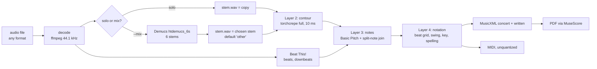

# System architecture

How audio becomes notation, what each stage writes to disk, and which model
or rule does the work. Current as of commit `955b1da` (2026-11-02).

## 1. Shape of the system



Four layers, each saved to its own files. A layer runs only when its files are
missing, when `--redo` names it or a layer below it, or when a layer below it
just ran. **No layer ever deletes a lower one**, so a hand-fixed `notes.json`
survives `--redo notation` ([ADR-0002](../decisions/0002-four-layers-on-disk.md)).

## 2. Layers

### Layer 1: isolate (`saxscribe/layers/isolate.py`)

| | |
| --- | --- |
| Input | Any audio file ffmpeg can read |
| Solo take | `stem.wav` is a copy of `source.wav` |
| Full mix (`--mix`) | Demucs `htdemucs_6s` separates drums, bass, vocals, guitar, piano, other. The chosen stem (`--stem`, default `other`) becomes `stem.wav`; the rest are summed into `accompaniment.wav`; all six stay in `stems/` to audition |
| Device | MPS, falling back to CPU if Demucs fails on the GPU |
| Stem choice | PR #24: the stem with the clearest single melody line, or a sum of stems when the sax is split (e.g. "guitar" + "other"); `--stem` overrides ([ADR-0020](../decisions/0020-pick-sax-stem-automatically.md)) |
| Known gap | No separator has a sax stem; "other" also carries other horns, strings and keys ([model card](../models/demucs.md)) |

### Layer 2: pitch contour (`saxscribe/layers/contour.py`)

| | |
| --- | --- |
| Input | `stem.wav`, resampled to 16 kHz |
| Model | torchcrepe, "full" capacity, 10 ms hop, limited to the horn's range ([model card](../models/crepe.md)) |
| Voicing | A frame is voiced when CREPE's confidence (periodicity, median-filtered over 3 frames) > 0.5 *and* the stem's loudness is above 1% of its peak |
| Fallback | pYIN (librosa) when torchcrepe isn't installed or `--contour-tool pyin` |
| Output | `contour.csv`: `time, f0_hz, midi, confidence, voiced`, one row per 10 ms |

### Layer 3: note events (`saxscribe/layers/notes.py`, `segment.py`)

| | |
| --- | --- |
| Default tool | Basic Pitch on `stem.wav` (onset threshold 0.5, frame threshold 0.3, minimum note 50 ms, horn's range, melodia trick on) ([model card](../models/basic-pitch.md)) |
| One line | Sax plays one note at a time: notes starting within 30 ms of each other keep the louder one; a note still sounding when the next starts is cut there |
| Split-note join | Optional (`--notes-tool basic_pitch_join`): same-pitch neighbours under 30 ms apart joined unless the stem shows a re-attack. Off by default since PR #22, because it merged real repeats ([model card](../models/note-rules.md)) |
| Other tools | `segment`: our CREPE Notes style cutter on the contour. `contour`: a simpler cutter on the contour plus librosa onsets |
| Per note | `cents`: median distance of the pitch line from the note, after the take's overall tuning |
| Beats | Beat This! `final0` checkpoint on the full `source.wav` (so the band's groove counts), librosa beat tracker as fallback ([model card](../models/beat-this.md)) |
| Output | `notes.json`: `notes[{onset, offset, pitch, cents, amp, tags}]`, `beats`, `downbeats`, `tempo_bpm`, `key` (null), `tools` |

### Layer 4: notation (`saxscribe/layers/notation.py`, `engrave.py`)

| Step | Rule |
| --- | --- |
| Time to beats | Seconds become beat positions along the tracked beat grid, so tempo drift follows the band. When the tracker finds too few beats (lone sax), the beat comes from the note onsets instead (PR #29, [ADR-0021](../decisions/0021-beat-from-notes-when-tracker-sparse.md)) |
| Swing | Off-beat eighths' average position gives the swing ratio (needs ≥6 off-beat notes); `--swing` overrides. Swung eighths are written as plain eighths |
| Grid | Each beat snaps to sixteenths, or to triplets when they fit clearly better (a 0.03-beat penalty per note favours sixteenths) |
| Gaps | Gaps under a third of a beat before the next note are closed, so tongued eighths read as eighths |
| Syncopation | PR #32: an off-beat eighth tied into the beat is written as one syncopated quarter or dotted quarter, within each half bar |
| Sax spans | PR #35: on band records, only stretches where the sax plays are written; notes elsewhere stay in `notes.json` tagged `not_sax`; cut stretches saved in `take.json` as `sax_cuts` ([ADR-0023](../decisions/0023-write-only-where-the-sax-plays.md)) |
| Key and spelling | music21's key finder on the notes; PR #34 adds length weighting and a blues profile so blues tunes get their home key ([ADR-0022](../decisions/0022-blues-aware-key-finding.md)); flats for chromatic notes in flat keys and C, sharps in sharp keys |
| Meter | 4/4 only for now |
| Readability (PR #21) | Swung pairs written as plain eighths, real triplets kept, runs of empty bars as one numbered rest, one enharmonic spelling per part from the horn's key ([ADR-0018](../decisions/0018-swing-aware-notation.md)). Any point on neither grid moves to sixteenths so MuseScore accepts every file (PR #26). Still too many 32nds and triplets on real recordings |
| Engraving | MuseScore command line turns each MusicXML into PDF, when installed (PR #12). Only for app and `transcribe` runs; test and scorecard runs never make PDFs (PR #36, [ADR-0024](../decisions/0024-no-pdfs-in-test-and-scorecard-runs.md)) |
| Missing beats | With almost no tracked beats (unaccompanied sax) every note is still written (PR #15, [ADR-0016](../decisions/0016-notation-never-drops-notes.md)) |

Outputs: `score.mid` (exact times, lines up with the audio), `score.musicxml`
(concert), `score-<horn>.musicxml` (written for the horn), `notation.json`
(key, swing, each note's bar and beat, with its index back into `notes.json`),
and `score.pdf` / `score-<horn>.pdf` when MuseScore is found.

## 3. A take's folder

```
take.saxscribe/
  take.json               which tool made each layer, with settings and time
  source.wav              decoded original; the time reference for every layer
  stem.wav                the sax on its own (copy for solo takes)
  accompaniment.wav       everything else (mixes only)
  stems/                  all six Demucs stems (mixes only)
  contour.csv             layer 2
  notes.json              layer 3
  score.mid               layer 4
  score.musicxml          layer 4, concert pitch
  score-alto.musicxml     layer 4, written for the horn
  score.pdf, score-alto.pdf   layer 4, when MuseScore is installed
  notation.json           layer 4 decisions
  flags.json              review flags from the play-along (PR #116); never changes the layers
```

Pitch is stored at concert pitch everywhere; transposition happens only at
display ([ADR-0003](../decisions/0003-concert-pitch-storage.md)). Planned: an
`edits/` folder holding the editor's operations as a diff against the model's
`notes.json`, which stays untouched.

Review flags (PR #116): in the play-along, the Flag button marks a bar, or picked notes in it, with one or more categories: Missing note, Extra note, Wrong pitch, Wrong octave, Held note split in two, Notes merged into one, Timing off, Rhythm written wrong, Bar line off / half time, Swing or feel wrong, Not sax, Other. An optional note can be added. Each flag saves the bar's start and end time in the recording, the notes written there and the tool version to `flags.json` beside the take's files, so a review can line it up with an answer key by time. A copy goes in `Desktop/Saxscribe/<song>/` with a text summary, which "Copy for Claude" in the Flags menu puts on the clipboard. Flags never change the transcription. Planned uses: bar-line flags for a "double the tempo here" fix (log E65), and Not sax flags for the sax-out list.

## 4. Instrument profiles (`saxscribe/horns.py`)

| Profile | Key | Written = concert + | Pitch range searched |
| --- | --- | --- | --- |
| alto (default) | Eb | major 6th (9 semitones) | 125–1600 Hz |
| tenor | Bb | major 9th (14) | 95–1100 Hz |
| baritone | Eb | octave + major 6th (21) | 60–800 Hz |

New instruments are added as new profiles, answer-key sets and (later) models,
not as rewrites ([ADR-0005](../decisions/0005-instrument-profiles-alto-first.md)).

## 5. Evaluation path (`saxscribe/score/`)

`python -m saxscribe score <set>` runs the same pipeline over a set of
recordings with known notes, keeps every take folder under
`~/saxscribe-runs/<set>/<settings>/`, and writes `scorecard.md` and
`scorecard.json`, and appends one line per run to `~/saxscribe-runs/results.jsonl` (PR #38; `--note` labels a run). The app's Results page (`/results`) plots that history together with `docs/evaluation/results.jsonl` and `changes.json` ([ADR-0025](../decisions/0025-scorecard-history-files.md)). Loaders live in `score/refs.py`; metrics in
`score/metrics.py`; the etude aligner in `score/align.py`. Details in
[evaluation/protocol.md](../evaluation/protocol.md).

## 6. Data management (`saxscribe/datasets.py`)

`datasets/manifest.json` lists 20 datasets (217 files) with page, licence,
access type and md5 per archive. `python -m saxscribe fetch` downloads,
checks and unpacks them into `~/mir_datasets/<folder>/` (archives in
`_zips/`). A download that fails its checksum is never kept; archives that
would write outside their folder are refused. Datasets that need a login are
listed with their page instead ([ADR-0011](../decisions/0011-dataset-manifest-and-fetch.md)).

## 7. Code boundary with Songs in the Key of Life

`saxscribe/frontend.py` is a private copy of the game analyzer's front end
(decode, Demucs, Beat This!, Basic Pitch) taken at game commit `18a6548`.
Nothing is imported from the game and nothing from its chart model came over.
Changes from the game's copy: no lanes or difficulty profiles; Basic Pitch
keeps notes down to 50 ms (game: 80 ms) because fast runs are the point;
beat detection takes a file.

## Deployment

| | Now | v1 |
| --- | --- | --- |
| Where it runs | Austin's M3 Pro MacBook, CLI | Same Mac, as a local web server |
| How it's used | Terminal | `python -m saxscribe app` (PR #14): iPad Safari over home Wi-Fi |
| Install | `setup_mac.sh`: Homebrew Python 3.11 + ffmpeg, private venv in `~/Library/Application Support/saxscribe/python`, symlinked as `.venv` | Same, plus the app server |
| Optional | MuseScore (`brew install --cask musescore`) for PDF; `[tools] musescore = "off"` skips it (PR #26) | Required for the PDF download |
| Training | None yet | Colab or a rented GPU; weights brought back to the Mac |

## 8. Dependencies (from `requirements.txt`)

| Package | Role |
| --- | --- |
| torch, torchaudio (<2.9) | Run the neural models; capped because newer torchaudio broke Demucs 4.0.1's audio saving |
| torchcrepe | Pitch contour |
| demucs | Stems for full mixes |
| beat_this (git) | Beats and downbeats |
| basic-pitch (Core ML on Mac, ONNX elsewhere), onnxruntime | Note events |
| librosa, scipy, numpy, soundfile | Audio loading, onsets, pYIN fallback, filters |
| music21 | Key, spelling, MusicXML |
| mido | MIDI out |
| mir_eval | Scoring |
| pytest | Tests |
